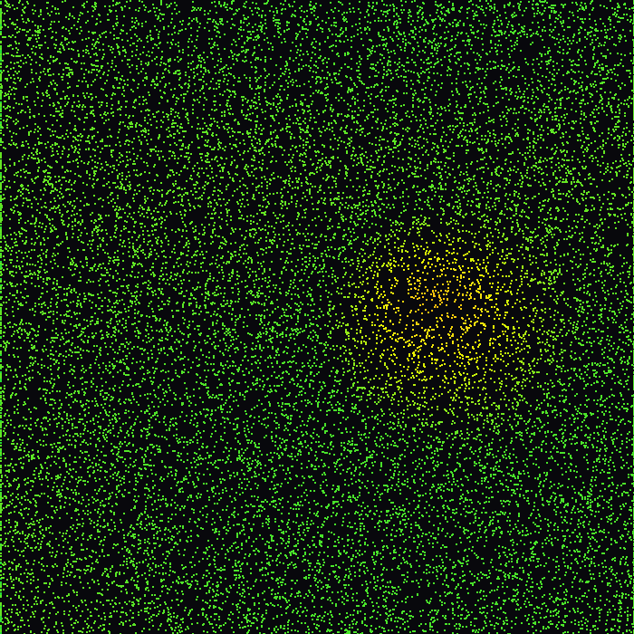

# GPU Aerodynamic Flow & Drag Simulator

 A high-performance aerodynamic vector field and airflow drag simulation running entirely on Apple Metal / GPU via Taichi and Python.

 

## Features
 - **GPU-Accelerated Particle Dynamics:** Simulates 50,000+ aerodynamic stream particles concurrently with zero CPU overhead.
 - **Dynamic Aerodynamic Drag Metric:** Color-coded telemetry visualizing flow regimes based on local shear and velocity dissipation:
   - 🟢 **Green:** Laminar / low-resistance freestream.
   - 🟡 **Yellow:** Transitional shear boundary.
   - 🔴 **Red:** Turbulent separation and high drag recirculation zones.
 - **Interactive Vortex Interaction:** Real-time vortex generator coupling smooth velocity transitions with mouse cursor influence.
 - **Automated Validation:** Test suite covering numeric stability and boundary encapsulation via `pytest`.

## Installation

 ```bash
 git clone https://github.com/Seyo2412/gpu-fluid-particle-simulator.git
 cd gpu-fluid-particle-simulator
 python3 -m venv venv
 source venv/bin/activate
 pip install -r requirements.txt
 ```

 ## Usage

 Run the interactive GPU simulation:

 ```bash
 python main.py
 ```

 Render the offline demo GIF:

 ```bash
 python scripts/export_demo_gif.py
 ```

 Run test suite:

 ```bash
 pytest
 ```

## Control

 Left Mouse Click & Drag: Introduce an aerodynamic obstacle and turbulence wake into the flow stream.

## Roadmap

 - [ ] Core SPH physics kernel (density, pressure, viscosity)
 - [ ] Spatial grid hashing for neighbor search
 - [ ] Interactive GPU viewport with velocity-based shaders
 - [ ] Obstacle collision and container interaction
 - [ ] Automated tests & demo GIF export